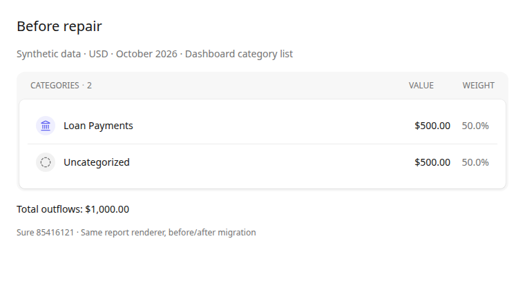
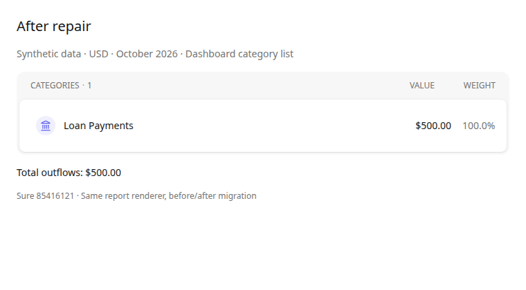

# Christso Sure fork

Repository: https://github.com/christso/sure

This fork keeps a small set of local repairs on top of
[we-promise/sure](https://github.com/we-promise/sure). This guide records the
differences and the process for updating the application. Update it whenever a
patch is added, changed, or retired.

## Branches

- `main` mirrors `we-promise/sure:main`. Keep it free of fork-specific commits.
- `christso/main` is the default branch and holds reviewed local patches. It
  starts at the deployed `v0.7.5-alpha.9` source commit,
  `ab457b47370ae69964a835acea96083edd4b13d9`, to keep this repair separate from
  an upstream version upgrade.
- `upstream` is the local Git remote for `https://github.com/we-promise/sure.git`.

The **Sync upstream main** workflow is scheduled every six hours. It checks that
`main` has no fork-only commits, uses GitHub's fork-sync API with the built-in
token, and verifies that the result matches upstream. It never changes
`christso/main`; upstream upgrades on that branch remain deliberate and tested.
Run the workflow manually for an immediate refresh. GitHub may disable scheduled
workflows on inactive public repositories, so verify its status before upgrades.

**Christso CI** runs the existing upstream CI suite on pushes to `christso/main`.
Upstream release and publishing workflows remain disabled in this fork; a source
push does not publish a release or deploy an application.

## Patch register

The application baseline is upstream `v0.7.5-alpha.9`, commit
[`ab457b47370ae69964a835acea96083edd4b13d9`](https://github.com/we-promise/sure/commit/ab457b47370ae69964a835acea96083edd4b13d9).
The upstream behavior below refers to that baseline, not every newer upstream
revision. Upstream tracking was checked on 2026-10-24.

| Area | Upstream baseline | Christso fork | Tracking and retirement condition |
| --- | --- | --- | --- |
| Reimporting matched transfers | Import-time kind inference can overwrite the kind assigned by transfer matching. A loan's receiving leg can become an expense again. | Preserve the kind of a transaction already linked to a transfer; cover SimpleFIN, Up, and the Redbark processor. | Backport of [upstream PR #3714](https://github.com/we-promise/sure/pull/3714), still open when checked. Remove the duplicate implementation when the chosen upstream revision includes equivalent behavior and regressions pass. |
| Existing misclassified loan inflows | Stale `loan_payment` kinds can double-count a paired repayment and appear under Uncategorized. | Repair transfer inflows to `funds_movement`; preserve the bank-side repayment. | Same upstream proposal. Reconcile migration versions and already-applied history before removing or replacing the local migration. |
| Cached reports after repair | The proposed upstream migration changes transaction kinds without touching the entries used to version cached reports. | Touch repaired entries' timestamps in the same SQL statement; a warm-cache regression verifies corrected totals. | Local addition to the proposed patch. Retain until the upgrade also invalidates cached reports correctly. |
| Repository automation | Upstream workflows serve the upstream project's branches and release infrastructure. | Mirror upstream into `main` every six hours; run CI on `christso/main`; keep inherited release/publishing workflows disabled. | Fork infrastructure, retained while these branch conventions apply. Recheck workflow changes and enabled workflows during upgrades. |

Regression evidence lives in the
[provider adapter tests](../test/models/account/provider_import_adapter_test.rb),
[Redbark processor tests](../test/models/redbark_account/processor_test.rb), and
[migration tests](../test/migrations/repair_loan_payment_on_transfer_inflows_migration_test.rb).
Host-specific configuration and private rollout records are outside this public
patch register.

## Loan-transfer repair details

The first patch backports upstream [PR #3714](https://github.com/we-promise/sure/pull/3714),
revision `492a9829c1e4ed86b427c2d72f695a86ea75ca6b`:

- Provider imports preserve the kind of transactions already paired by a transfer.
- A data migration resets stale `loan_payment` kinds on transfer inflows to
  `funds_movement`. Bank-side repayments keep their existing budget treatment.
- Regression coverage includes the upstream SimpleFIN/Up scenarios and the
  actual Redbark transaction processor, with pending and confirmed transfer links.
- The repair also touches the repaired entries' timestamps to invalidate cached
  financial reports. A warm-cache regression covers this addition to the upstream patch.

The migration covers existing transfer inflows across the database, including
pending links. It changes transaction kinds and repaired entry timestamps;
categories, amounts, balances and transfer links are preserved. It is idempotent
and its down migration is irreversible.
Review its affected set on a protected database copy and verify a recoverable
database backup before production rollout. Rolling back the image does not undo
this data repair.

Source preparation and CI do not authorize or perform a production migration.
Build and deploy a pinned image only after validating the target database and
the web/worker rollout together. Keep production data and credentials out of
this public source repository and GitHub Actions.

## Upstream update policy

Keeping the mirror current and upgrading the deployed application are separate
operations. The six-hour workflow handles only the mirror. It does not merge
into `christso/main`, build a production image, or deploy anything.

The maintainer of this fork owns the following review cadence. These reviews and
upgrade steps are manual; the only scheduled automation currently installed is
the mirror workflow.

| When | Action | Completion evidence |
| --- | --- | --- |
| Every six hours, automated | Fast-forward `main` from upstream and verify matching heads. | Successful [Sync upstream main run](https://github.com/christso/sure/actions/workflows/christso-sync-upstream.yml). Check failures and disabled schedules. |
| Weekly, and before each upgrade | Check upstream releases, security advisories, mirror health, and patch tracking. Select a release or reviewed commit; record any reason for deferring it. | Reviewed target tag and full SHA, patch-register status, and an upgrade issue or PR when work is needed. |
| On a relevant security advisory | Assess exposure promptly and prioritize the fix through the same validation and rollout process. | Recorded applicability, chosen fix, and verified deployed revision. |
| For each approved upgrade | Merge a pinned upstream revision into a candidate branch, validate, promote to `christso/main`, and deploy a pinned image. | Green checks, migration rehearsal, recoverable backup, and post-deploy verification. |

Prefer a reviewed release when suitable. This baseline is itself an alpha, so a
release tag alone is not evidence that an upgrade is safe. Do not accumulate
unrelated local features or rewrite upstream modules to carry a small repair.
Offer generally useful fixes upstream and retire local copies when equivalent
fixes reach the version we adopt.

### Prepare an upgrade

First verify the mirror and inspect the target's release notes, migrations,
dependencies, and workflows. A manual mirror refresh remains available:

```sh
git fetch upstream main
git switch main
git merge --ff-only upstream/main
git push origin main
```

Create an upgrade candidate from the current patch branch. Replace
`REVIEWED_UPSTREAM_SHA` below with the full commit SHA selected during review:

```sh
git fetch origin main christso/main
git switch -c upgrade/sure-YYYY-MM-DD origin/christso/main
git merge --no-ff REVIEWED_UPSTREAM_SHA
```

Resolve conflicts and audit the patch register against the merged source. Open
the upgrade PR against **`christso/main`**, even though the upstream contributor
guide normally targets `main`. Never merge a fork patch or an upgrade PR into
the upstream mirror. Keep upgrade merges in history; do not rebase the deployed
patch branch or force-push either long-lived branch.

Before promotion:

1. Run the full repository pre-PR checklist and the transfer/migration
   regressions. The existing **Christso CI** push trigger covers
   `christso/main`, not candidate branches. After local checks pass and the
   candidate is pushed, run `gh workflow run christso-ci.yml --ref upgrade/sure-YYYY-MM-DD`
   and verify that run passed at the candidate SHA. After promotion, confirm
   **Christso CI** is green before deploying.
2. Restore a protected production backup into an isolated rehearsal environment.
   Inspect all pending migrations, rehearse them, compare report totals and
   financial records, and replay imports without contacting live providers.
   Keep this data and its credentials out of GitHub Actions and the public repo.
3. Check for an upstream equivalent of each local patch. For this repair,
   preserve already-applied migration history and verify report-cache
   invalidation; a matching PR title or an importer-only fix is insufficient.
4. Update this guide, including baseline, patch statuses, and any screenshots
   whose results changed. Review newly introduced workflows and fork settings.

### Promote and deploy

Merge the reviewed candidate into `christso/main`, check the CI result, and build
an immutable image from that exact revision. Record the upstream target, fork
SHA, image digest, and validation results in the deployment record. Keep sensitive
operational details in private records.

For the target installation, verify a recoverable backup, coordinate web and
worker versions and migration execution, then verify health, report totals,
transfer kinds, and a subsequent import. Record the deployed digest and outcome.
The mirror's current SHA is not the deployed version.

Keep the previous image and a tested database recovery path. Image rollback
alone cannot undo an irreversible migration; choose rollback or a forward fix
according to the actual schema and data changes rehearsed for that upgrade.

## Visual comparison

Use the same synthetic fixture, period, currency, viewport, and capture method
for both states. Label the source revision and whether the image shows the
upstream baseline, an unrepaired data state, or the patched result. Screenshots
illustrate the report; regression tests verify import persistence, pending
transfers, cache invalidation, and preserved financial records.

For the loan-transfer repair, the comparison fixture is a USD 500 repayment from
a checking account to a loan account, with the bank side categorized as Loan
Payments and the matched loan inflow carrying the stale `loan_payment` kind:

| Dashboard result | Before repair | After repair |
| --- | ---: | ---: |
| Loan Payments | $500 | $500 |
| Uncategorized | $500 | $0 (row disappears) |
| Total outflows | $1,000 | $500 |

These captures use the real dashboard category-list partial and report queries
at fork revision `854161212bf25666524ec62d20cd70939b3dc965`, before and after the
repair migration. They illustrate the unrepaired data state and the repaired
result on the same renderer; they are not captures of two separately running
upstream and fork installations. See the [capture notes and reproduction steps](images/christso/README.md).

| Before repair | After repair |
| --- | --- |
|  |  |

Publish only captures made from synthetic data. Never use household dashboard
screenshots, account identifiers, provider credentials, or private deployment
records. Keep paired images and their reproduction notes current when a patch's
visible behavior changes.
